<div align="center">
  
</div>

<br>

### About Me

Offensive security and privacy enthusiast focused on Linux environments, network protocols, and real-time systems. Currently auditing vulnerable machines, building privacy-respecting tools, and practicing CTF methodologies.

---

### Featured Repositories

- [**s7ghost**](https://github.com/s7mu/s7ghost) — Ephemeral, zero-persistence text, note, and code snippet transfer tool. Runs 100% in volatile RAM with native WebSockets and client-side E2EE (AES-GCM-256).
- [**dockerlabs-writeups**](https://github.com/s7mu/dockerlabs-writeups) — Detailed, step-by-step offensive security methodologies and walkthroughs for vulnerable DockerLabs environments.

---

### Focus & Tooling

```text
Offensive Security : Nmap • Burp Suite • SQLMap • Hydra • GTFOBins • Metasploit
Platforms & Systems: Linux (Arch / Debian) • Docker • Bash • Networking • WebSockets
```
